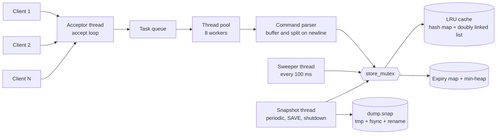

# MiniRedis

A multithreaded, in-memory key-value store written from scratch in C++17, modeled on Redis. Clients connect over TCP and send text commands (`SET`, `GET`, `EXPIRE`, ...). It handles many concurrent clients, evicts the least recently used keys when full, expires keys on a timer, and survives restarts through atomic disk snapshots.

Built to learn systems fundamentals: sockets, threads and locks, data structures, and durability.

## Features

- **TCP server** with a thread pool (8 workers) and a custom line-based protocol. Handles partial and batched reads by buffering and splitting on newlines.
- **LRU eviction** with a hash map plus a hand-written doubly linked list: O(1) get, put and evict.
- **Key expiry** (`EXPIRE`, `TTL`) with lazy expiry on access plus an active sweeper driven by a min-heap.
- **Snapshots** (`SAVE`, periodic, and on shutdown) written atomically: temp file, `fsync`, `rename`.
- **Corruption protection:** the loader validates the file and refuses to start on a damaged snapshot.
- **Tests** for the LRU cache and a CMake build with `ctest`.

## Architecture



## Build and run

Requires Linux, g++ with C++17, and CMake 3.10 or newer.

```bash
cmake -S . -B build
cmake --build build -j2
(cd build && ctest --output-on-failure)      # run the tests

./build/server [max_keys] [snapshot_interval_s]
# defaults: 1000 keys, snapshot every 30 s (0 turns periodic snapshots off)
```

Talk to it with netcat:

```bash
printf 'SET name Tarun\nGET name\nEXPIRE name 60\nTTL name\n' | nc -q1 localhost 6380
```

## Commands

| Command | Reply | Description |
|---|---|---|
| `SET key value` | `OK` | Store a value (may contain spaces). Clears any existing expiry. |
| `GET key` | value or `(nil)` | Read a value. Counts as a use for LRU. |
| `DEL key` | `(integer) 1` or `0` | Delete a key. |
| `EXPIRE key seconds` | `(integer) 1` or `0` | Make a key expire after N seconds (1 to 31536000). |
| `TTL key` | seconds, `-1` or `-2` | Seconds left; `-1` = no expiry, `-2` = key does not exist. |
| `SAVE` | `OK` | Write a snapshot to `dump.snap` now. |
| `LASTSAVE` | epoch seconds | Time of the last successful snapshot. |
| `DBSIZE` | `(integer) N` | Number of keys. |
| `INFO` | one line | Size, capacity, evictions, expiry counters, save status. |

## Design decisions

- **One global mutex.** Even `GET` writes (it reorders the LRU list), so a reader/writer lock would be unsafe. Simple and correct; it is also the throughput limit (see Benchmarks). I proved the need for it: without the lock, 8 clients inserting 40,000 keys crashed the server with a segmentation fault.
- **Thread pool, one connection per worker.** Simple to reason about, but a connection occupies a worker for its whole lifetime, so at most 8 clients are served at once. An `epoll` event loop would remove that limit.
- **Lazy plus active expiry.** Lazy alone leaves dead keys in memory until someone reads them; active alone is periodic and not exact. Together they are correct and memory-friendly.
- **Min-heap with lazy deletion.** The sweeper looks only at the soonest deadline. Stale heap entries (deleted or re-expired keys) are discarded by comparing against the `expires` map.
- **Eviction callback.** When the LRU evicts a key, its expiry record is removed too, so no orphaned records leak.
- **Absolute expiry times in snapshots.** Downtime counts against a key's lifetime, so keys that died while the server was off stay dead.
- **Atomic snapshots.** Write to `dump.snap.tmp`, `fsync`, then `rename`: the file on disk is always a complete old or complete new snapshot. The data is copied under the lock and written after releasing it, so slow disk I/O does not block clients.

## Benchmarks

Measured with the included load generator (`bench.cpp`, `run_bench.sh`, `summarize.sh`). Raw output is in `bench_run1.txt` to `bench_run3.txt`.

- **Machine:** 2 cores | AMD EPYC 7763 64-Core Processor
- **Setup:** `build/server` (Release, `-O2`), 8 workers, 100,000 key capacity, snapshots off. Client and server run on the same machine, over localhost.
- **Workload:** 50% `SET` / 50% `GET`, 32-byte values, 20,000 requests per client, one request in flight per client, all clients start together.
- **Method:** median of 3 runs per row.

| Clients | Throughput (ops/s) | Avg latency (µs) | p95 (µs) | p99 (µs) |
|---:|---:|---:|---:|---:|
| 1 | 22,501 | 44 | 57 | 75 |
| 2 | 54,368 | 36 | 44 | 60 |
| 4 | 51,667 | 76 | 115 | 149 |
| 8 | 47,964 | 164 | 238 | 529 |
| 16 | 49,318 | 240 | 230 | 348 |

**What the numbers show:** Throughput rises from about 22,500 ops/s with 1 client to about 54,400 with 2 clients, then stays between roughly 48,000 and 52,000 up to 16 clients while latency keeps growing (average 36 µs at 2 clients, 164 µs at 8). The machine has 2 cores shared by the server and the load generator, and every command takes one global lock, so clients beyond the second mostly add waiting. At 16 clients, throughput is about the same as at 8, because the pool has only 8 workers and each connection holds a worker, so only 8 clients are served at a time while the other 8 wait.

**Caveats:** the load generator shares the CPU with the server, so absolute numbers understate what the server could do alone, and they are not comparable to real Redis. Each client has one request in flight (no pipelining). These are a single-machine, relative picture of this design.

## Tests

`lru_test`, `lru_expiry_test` and `lru_order_test` cover eviction order, recency refresh on update, eviction callbacks, and order-preserving replay for snapshots. Run with `ctest`.

## Project layout

```
main.cpp              server: networking, thread pool, commands, expiry, snapshots
lru.h                 LRU cache (hash map + doubly linked list)
bench.cpp             load generator
run_bench.sh          runs the benchmark for 1, 2, 4, 8, 16 clients
summarize.sh          takes the median of several benchmark runs
load_test.sh          concurrency correctness check (8 clients x 5000 SETs = 40000 keys)
lru*_test.cpp         unit tests
notes.md              daily build log with experiments
```

## Limitations and next steps

- A crash loses writes after the last snapshot. Next step: an append-only log (AOF) like Redis.
- The thread pool caps concurrency at 8 clients. Next step: `epoll`-based event loop.
- The single lock serializes all commands. Next step: shard the keyspace across several independent caches.
- Text protocol with no authentication. Not for production use.